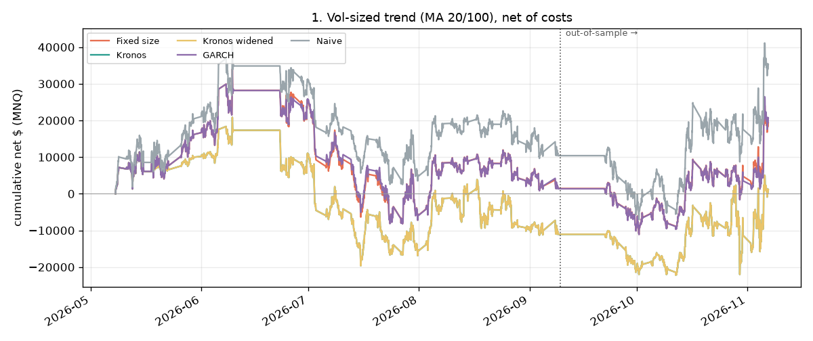
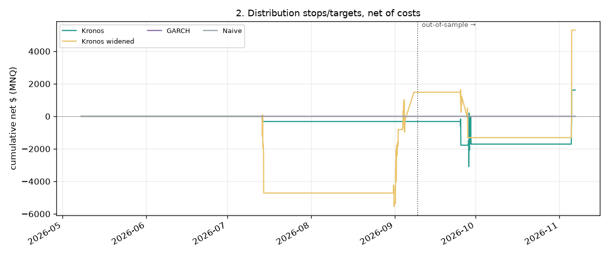
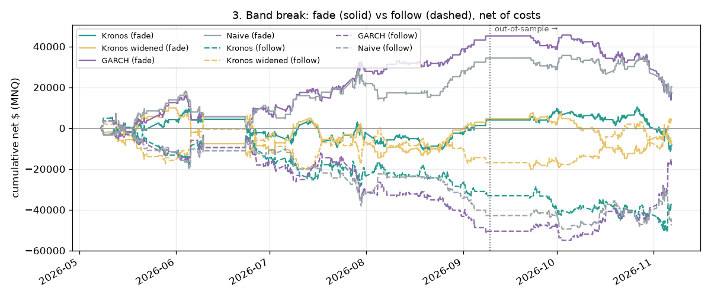

# NQ Kronos strategy lab: report

_Generated 2026-11-08 02:51 UTC by `lab/backtest.py` from cached forecasts. Research only — not investment advice._

## Setup

- **Period:** 2026-05-07 22:00 → 2026-11-06 21:00 UTC; 973 forecast origins (every 3rd closed bar) common to all band sources (973 Kronos forecasts cached).
- **Split:** in-sample = origins before 2026-09-09 14:00 UTC (first two-thirds); out-of-sample = the final third. Fitted on in-sample only: the Kronos widening multiplier (**×2.16**) and each source's vol-sizing reference width.
- **Kronos:** Kronos-small, 512-bar context, 24 steps, 30 sampled paths, T=1.0, top_p=0.9, only bars up to each origin. **GARCH:** GARCH(1,1), Student-t, zero mean, refitted at every origin on the previous 2000 hourly returns, 1,000 simulated paths. **Naive:** no-change median, band from trailing 20-day realised volatility (normal, √h scaling).
- **Kronos widened:** each quantile moved away from the median by the fitted multiplier (P10′ = P50 + m·(P10 − P50), same for the others), at every horizon.
- **Costs:** MNQ ($2/pt); 1 tick slippage each way + $1.00 commission per side per contract; slippage doubled for fills in bars starting 22:00–07:00 London. Entries at the next bar's open.
- **Rolls:** prices are back-adjusted; 9 of 10 roll gaps are estimates (Yahoo drops expired contracts). No position is held inside a roll window (roll date − 1 day to expiry + 4 days), and forecasts whose 24 hours touch one are left out of calibration (148 of 973).
- **Sizes:** fixed rules trade 5 MNQ; vol-sized trend trades 5 × (reference width ÷ current +24h P10–P90 width), rounded, clipped to 1–15.

## Calibration: share of actual closes inside P10–P90 (target ≈ 80%)

**All** — 825 forecasts

| Band source | +1h | +6h | +24h | Avg +24h width (pts) |
|---|--:|--:|--:|--:|
| Kronos | 51% | 50% | 46% | 675 |
| Kronos widened | 79% | 81% | 77% | 1,458 |
| GARCH | 80% | 80% | 84% | 998 |
| Naive | 84% | 83% | 83% | 979 |

**In-sample (first 2/3)** — 565 forecasts

| Band source | +1h | +6h | +24h | Avg +24h width (pts) |
|---|--:|--:|--:|--:|
| Kronos | 52% | 53% | 49% | 720 |
| Kronos widened | 79% | 83% | 80% | 1,554 |
| GARCH | 78% | 83% | 84% | 1,017 |
| Naive | 85% | 87% | 86% | 1,060 |

**Out-of-sample (final 1/3)** — 260 forecasts

| Band source | +1h | +6h | +24h | Avg +24h width (pts) |
|---|--:|--:|--:|--:|
| Kronos | 50% | 43% | 40% | 578 |
| Kronos widened | 79% | 76% | 70% | 1,249 |
| GARCH | 85% | 75% | 84% | 957 |
| Naive | 81% | 74% | 76% | 804 |

## Strategy 1: vol-sized trend (MA 20/100, always in the market)

Same entries and exits for every row; only the position size differs. Kronos and Kronos widened size identically by construction (a constant multiplier cancels out against the reference width).

| Band source | Period | Trades | Win rate | Avg trade (pts) | Avg trade ($ net) | Total net $ | Sharpe | Max drawdown | Avg size |
|---|---|--:|--:|--:|--:|--:|--:|--:|--:|
| Fixed size | All | 35 | 34% | +57.1 | $554 | $19,402 | +0.65 | $45,095 | 5.0 |
| Fixed size | In-sample | 23 | 30% | +8.0 | $62 | $1,432 | +0.07 | $42,185 | 5.0 |
| Fixed size | Out-of-sample | 12 | 42% | +151.4 | $1,498 | $17,970 | +1.88 | $14,130 | 5.0 |
| Kronos | All | 35 | 34% | +57.1 | $34 | $1,197 | +0.04 | $43,014 | 5.3 |
| Kronos | In-sample | 23 | 30% | +8.0 | −$481 | −$11,056 | -0.63 | $40,476 | 5.2 |
| Kronos | Out-of-sample | 12 | 42% | +151.4 | $1,021 | $12,253 | +1.03 | $24,356 | 5.4 |
| Kronos widened | All | 35 | 34% | +57.1 | $34 | $1,197 | +0.04 | $43,014 | 5.3 |
| Kronos widened | In-sample | 23 | 30% | +8.0 | −$481 | −$11,056 | -0.63 | $40,476 | 5.2 |
| Kronos widened | Out-of-sample | 12 | 42% | +151.4 | $1,021 | $12,253 | +1.03 | $24,356 | 5.4 |
| GARCH | All | 35 | 34% | +57.1 | $591 | $20,699 | +0.70 | $45,164 | 5.0 |
| GARCH | In-sample | 23 | 30% | +8.0 | $59 | $1,363 | +0.07 | $42,242 | 5.0 |
| GARCH | Out-of-sample | 12 | 42% | +151.4 | $1,611 | $19,336 | +1.98 | $14,130 | 5.1 |
| Naive | All | 35 | 34% | +57.1 | $1,010 | $35,342 | +1.00 | $48,988 | 6.0 |
| Naive | In-sample | 23 | 30% | +8.0 | $452 | $10,398 | +0.47 | $39,372 | 5.5 |
| Naive | Out-of-sample | 12 | 42% | +151.4 | $2,079 | $24,944 | +1.88 | $19,782 | 6.9 |

## Strategy 2: distribution stops and targets

Enter on an MA crossover; stop just beyond +24h P10 (P90 for shorts), target +24h P75 (P25); skip if reward ÷ risk < 1; exit on stop, target, opposite crossover or after 24 bars. Crossovers skipped for reward/risk < 1: Kronos 28, Kronos widened 26, GARCH 32, Naive 32. Note: for a band roughly symmetric around the last close, P75 is ~0.67σ away and P10 ~1.28σ, so reward ÷ risk ≈ 0.5 and most crossovers are skipped; the rule only trades when a forecast's distribution leans strongly in the trade's direction. The rule was fixed in advance and is reported as specified.

| Band source | Period | Trades | Win rate | Avg trade (pts) | Avg trade ($ net) | Total net $ | Sharpe | Max drawdown |
|---|---|--:|--:|--:|--:|--:|--:|--:|
| Kronos | All | 4 | 50% | +42.0 | $403 | $1,614 | +0.51 | $3,096 |
| Kronos | In-sample | 1 | 0% | -29.7 | −$317 | −$317 | -2.27 | $317 |
| Kronos | Out-of-sample | 3 | 67% | +65.9 | $644 | $1,931 | +1.05 | $2,931 |
| Kronos widened | All | 6 | 50% | +90.0 | $883 | $5,300 | +0.91 | $5,641 |
| Kronos widened | In-sample | 4 | 50% | +38.8 | $370 | $1,481 | +0.45 | $5,641 |
| Kronos widened | Out-of-sample | 2 | 50% | +192.6 | $1,910 | $3,819 | +1.58 | $2,943 |
| GARCH | All | 0 | – | – | – | $0 | – | $0 |
| GARCH | In-sample | 0 | – | – | – | $0 | – | $0 |
| GARCH | Out-of-sample | 0 | – | – | – | $0 | – | $0 |
| Naive | All | 0 | – | – | – | $0 | – | $0 |
| Naive | In-sample | 0 | – | – | – | $0 | – | $0 |
| Naive | Out-of-sample | 0 | – | – | – | $0 | – | $0 |

## Strategy 3: band break, fade vs follow

Within 6 hours of a forecast, the first close outside that hour's P10–P90 triggers a trade at the next open: **fade** (against the break, target the median) or **follow** (with the break). Stop one band-width from entry; exit after 6 hours.

**3a. Fade**

| Band source | Period | Trades | Win rate | Avg trade (pts) | Avg trade ($ net) | Total net $ | Sharpe | Max drawdown |
|---|---|--:|--:|--:|--:|--:|--:|--:|
| Kronos | All | 401 | 53% | -0.4 | −$21 | −$8,356 | -0.51 | $21,676 |
| Kronos | In-sample | 265 | 54% | +3.2 | $15 | $4,042 | +0.36 | $20,163 |
| Kronos | Out-of-sample | 136 | 51% | -7.5 | −$91 | −$12,398 | -2.36 | $21,676 |
| Kronos widened | All | 225 | 53% | -1.2 | −$29 | −$6,480 | -0.39 | $24,825 |
| Kronos widened | In-sample | 157 | 56% | +4.6 | $29 | $4,626 | +0.42 | $24,466 |
| Kronos widened | Out-of-sample | 68 | 47% | -14.7 | −$163 | −$11,106 | -2.03 | $22,364 |
| GARCH | All | 224 | 55% | +9.3 | $77 | $17,257 | +1.05 | $31,877 |
| GARCH | In-sample | 158 | 61% | +30.3 | $286 | $45,201 | +4.06 | $16,958 |
| GARCH | Out-of-sample | 66 | 42% | -40.7 | −$423 | −$27,944 | -5.25 | $31,877 |
| Naive | All | 178 | 59% | +13.1 | $114 | $20,339 | +1.28 | $20,069 |
| Naive | In-sample | 113 | 65% | +32.0 | $304 | $34,334 | +3.29 | $17,661 |
| Naive | Out-of-sample | 65 | 48% | -19.9 | −$215 | −$13,995 | -2.55 | $20,069 |

**3b. Follow**

| Band source | Period | Trades | Win rate | Avg trade (pts) | Avg trade ($ net) | Total net $ | Sharpe | Max drawdown |
|---|---|--:|--:|--:|--:|--:|--:|--:|
| Kronos | All | 326 | 37% | -9.8 | −$115 | −$37,376 | -1.80 | $56,306 |
| Kronos | In-sample | 222 | 37% | -13.3 | −$149 | −$33,134 | -2.50 | $38,591 |
| Kronos | Out-of-sample | 104 | 38% | -2.4 | −$41 | −$4,242 | -0.57 | $22,116 |
| Kronos widened | All | 204 | 49% | +3.7 | $20 | $4,115 | +0.21 | $27,314 |
| Kronos widened | In-sample | 139 | 45% | -10.5 | −$122 | −$16,935 | -1.30 | $27,314 |
| Kronos widened | Out-of-sample | 65 | 57% | +34.0 | $324 | $21,050 | +3.17 | $13,761 |
| GARCH | All | 205 | 44% | -7.1 | −$88 | −$17,946 | -0.86 | $61,311 |
| GARCH | In-sample | 142 | 40% | -33.9 | −$356 | −$50,488 | -3.66 | $57,394 |
| GARCH | Out-of-sample | 63 | 54% | +53.3 | $517 | $32,542 | +4.66 | $8,855 |
| Naive | All | 167 | 38% | -26.8 | −$284 | −$47,425 | -2.55 | $56,749 |
| Naive | In-sample | 104 | 34% | -39.6 | −$412 | −$42,839 | -3.43 | $50,137 |
| Naive | Out-of-sample | 63 | 46% | -5.6 | −$73 | −$4,586 | -0.75 | $17,395 |

## Verdict

Out of sample, the +24h band held the actual close 40% of the time for raw Kronos, 70% for Kronos widened (×2.16, fitted in-sample), 84% for GARCH and 76% for naive (target ≈ 80%). Closest to 80%: **GARCH**. **No — raw Kronos is not better calibrated than GARCH;** its band is too narrow. Even the widened Kronos band does not beat GARCH out of sample.

Out of sample, after costs, a Kronos band source made more money than the same rule on GARCH bands in: 2. stops/targets: Kronos $1,931 vs GARCH $0 out-of-sample; 2. stops/targets: Kronos widened $3,819 vs GARCH $0 out-of-sample. Treat this with caution: one period, a few hundred trades at most, and no correction for having tried several rules and four band sources.

Caveats: a single ~6-month period dominated by one market regime; Kronos uses 30 paths per forecast (quantiles are noisy); roll gaps before Sep 2026 are estimated; Yahoo data is delayed and unofficial. Anything that looks good here should go to a demo account before real money.
